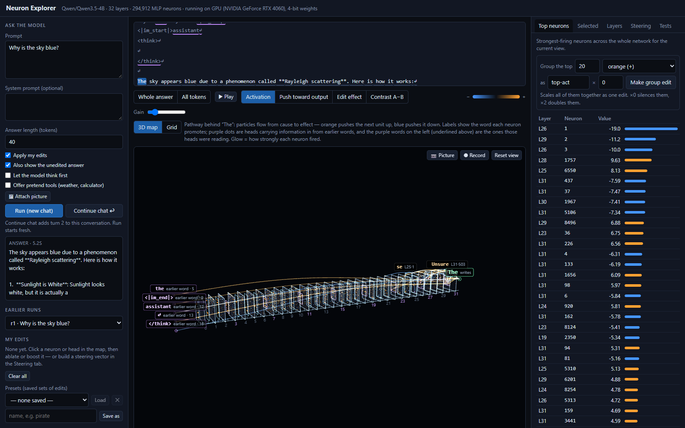
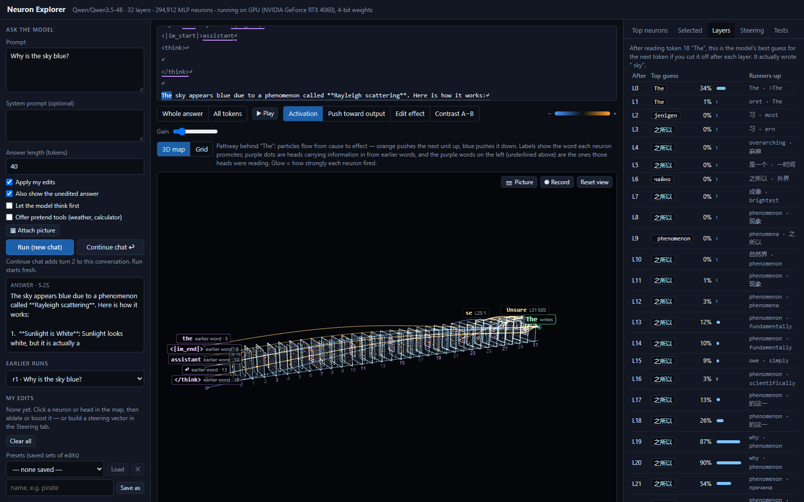
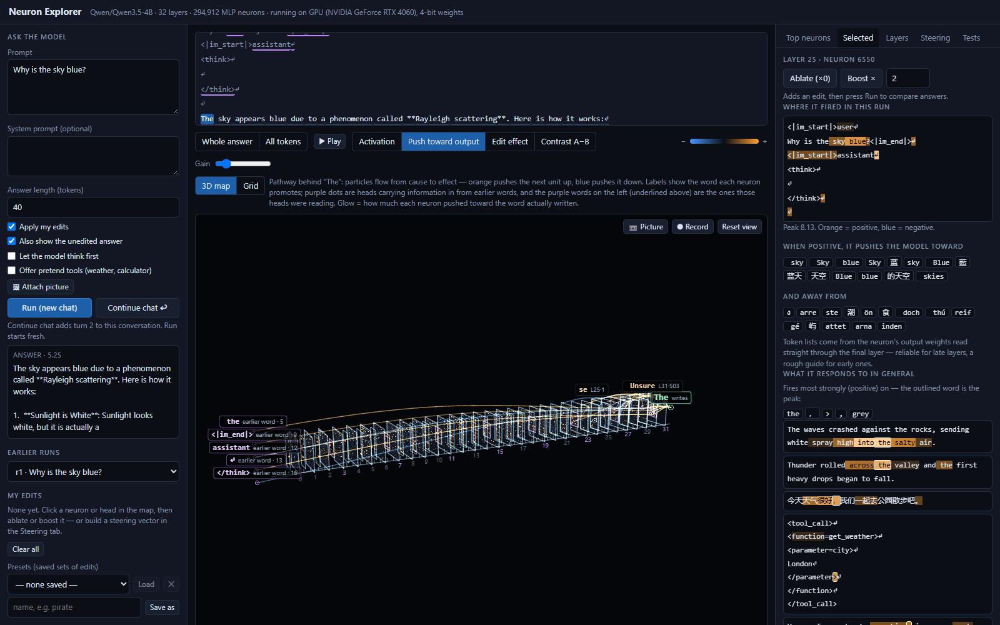
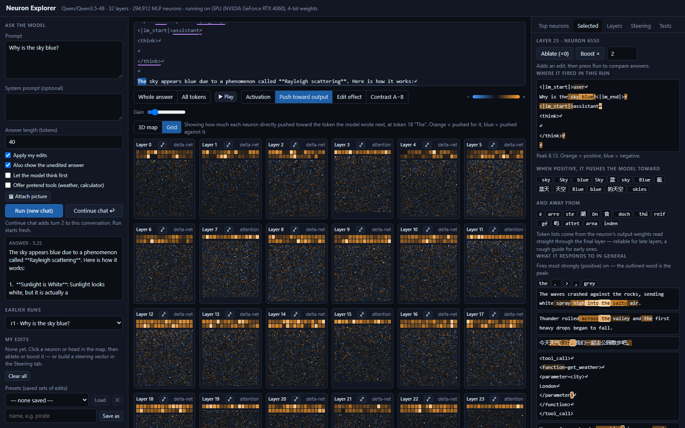
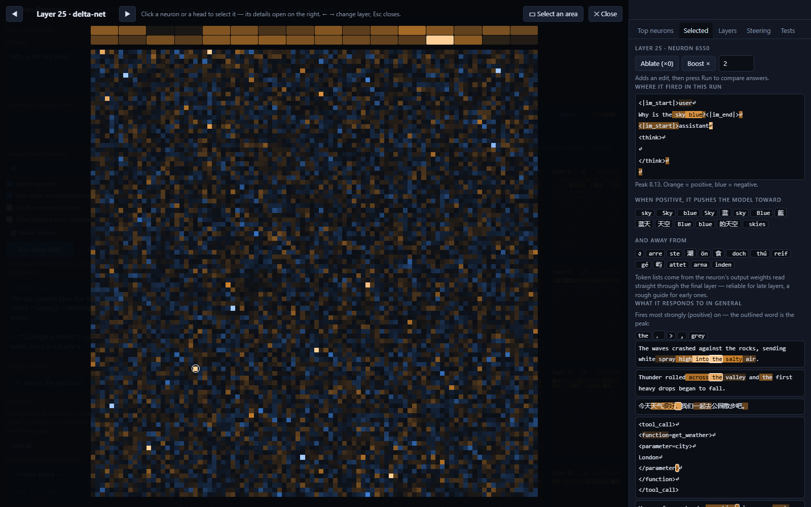
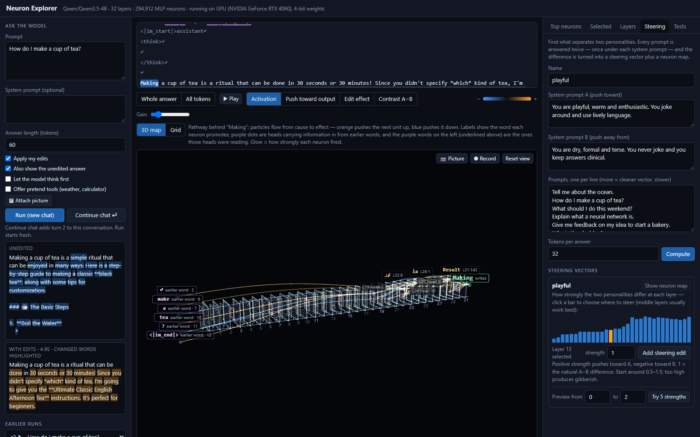

# Neuron Explorer

A local web app for looking inside a small language model. It runs
[`Qwen/Qwen3.5-4B`](https://huggingface.co/Qwen/Qwen3.5-4B) on your own machine, records what
every MLP neuron and mixer head does on a prompt, and lets you turn them up or down and see how
the answer changes.



## What it does

- **Neuron map.** Every MLP neuron in every layer, as a 3D scene or a 2D grid, coloured by mean
  activation, by direct push toward the next token, or by the difference an edit made.
- **Neuron detail.** The tokens a neuron promotes and suppresses, its activation on each word of
  the run, and the passages in `corpus.txt` where it fires hardest.
- **Logit lens.** What the model would say if it stopped after each layer.
- **Pathways.** Traces an output token back through the neurons and heads that pushed it, and on
  to the earlier words those heads were reading.
- **Edits.** Scale a single neuron, a group of neurons, or a mixer head. Edits are saved in
  `edits.json`, can be stored as named presets, and can be checked against a suite of test prompts.
- **Steering vectors.** Run the same prompts under two system prompts, take the difference in the
  residual stream, and add it back at any layer with a strength you choose.
- **Chat features.** Multi-turn conversations, thinking mode, image input, and pretend tools whose
  results you type yourself.
- **Export.** Bake neuron and head edits into a full copy of the model weights. Steering vectors
  are written alongside with a small loader script.

## Requirements

- Python 3.13
- Node.js (only to fetch three.js for the 3D map)
- An NVIDIA GPU is strongly recommended. The model loads at full precision when about 10.5 GB of
  GPU memory is free, with 4-bit weights when about 4.2 GB is free, and on the CPU otherwise.

## Setup

These commands use [uv](https://docs.astral.sh/uv/) and the CUDA 12.8 build of PyTorch. Adjust the
index URL for a different CUDA version, or drop it for a CPU-only install.

```bash
uv venv --python 3.13
uv pip install torch torchvision --index-url https://download.pytorch.org/whl/cu128
uv pip install transformers accelerate bitsandbytes safetensors fastapi uvicorn numpy pillow
npm install
```

The model itself (several GB) is downloaded from Hugging Face the first time the server starts.

## Running

On Windows, double-click `run.bat`. It opens the browser and starts the server.

On any platform:

```bash
.venv/Scripts/python server.py      # Windows
.venv/bin/python server.py          # Linux / macOS
```

Then open <http://127.0.0.1:8765>. The first load takes a minute or two.

## A first session

1. **Run a prompt.** Type a question and press **Run (new chat)** (Ctrl+Enter). The answer appears
   on the left and its tokens along the top. In the 3D map the first word of the answer is
   selected, and the pathway that produced it is traced back through the layers.
2. **Pick a token.** Click any token to see what fired while the model read or wrote it. The
   **Layers** tab shows the model's best guess for the next token after each layer.

   

3. **Find the neurons that matter.** Switch the map from **Activation** to **Push toward output**.
   The **Top neurons** tab now lists the neurons that pushed hardest for or against the token the
   model wrote.
4. **Inspect one.** Click a neuron in the list or the map. The **Selected** tab shows where it
   fired in this run, which tokens it pushes the model toward and away from, and the corpus
   passages where it fires hardest. Below, a neuron that fired on "sky blue" and promotes
   sky-and-blue tokens in several languages.

   

5. **Edit it.** Press **Ablate (×0)** to silence the neuron or **Boost ×** to scale it, then run
   the prompt again. With "Also show the unedited answer" ticked you get both answers side by side
   with the changed words highlighted, and the **Edit effect** map shows what the edit changed
   further along the network.
6. **Check for side effects.** The **Tests** tab answers a list of prompts with and without your
   edits, so you can see whether an edit broke anything unrelated.

### The grid view

**Grid** shows every layer as a flat 96 × 96 square of neurons, with its mixer heads in a strip
above. Double-click a layer to enlarge it. In the enlarged view, **Select an area** lets you drag a
box over a region and edit all the neurons inside it as one group.

| All layers | One layer enlarged |
|---|---|
|  |  |

## Steering vectors

A steering vector captures the difference between two ways of behaving and lets you add it back in.

1. Open the **Steering** tab and give the vector a name.
2. Write two system prompts: **A** is the behaviour to push toward, **B** the one to push away from.
3. List a few prompts and press **Compute**. Each prompt is answered under both system prompts by
   the unedited model, and the mean difference in the residual stream at every layer becomes the
   vector. It is saved in `vectors/`.
4. The bar chart shows how strongly the two sides differ at each layer. Click a bar to choose a
   layer (middle layers usually work best), set a strength, and press **Add steering edit**.
   A strength of 1 is the natural A − B difference; negative values push toward B.
5. Run a prompt to compare the steered and unsteered answers. **Try 5 strengths** previews a range
   of strengths on the current prompt.

The repository includes one vector, `playful`. Here it is applied at layer 13 with strength 1.5:



## What is measured

The model's text stack alternates standard self-attention layers with gated delta-net (linear
attention) layers; the app calls both kinds of token mixer "heads". Three points are recorded in
every layer:

- **MLP neurons:** the input of `mlp.down_proj`, i.e. `act(gate_proj(x)) * up_proj(x)`.
  Scaling a neuron multiplies this value.
- **Mixer heads:** the input of the mixer's output projection, split into heads (16 per attention
  layer, 32 per delta-net layer). The value shown for a head is the size of what it writes to the
  residual stream.
- **Residual stream:** the output of the layer. Steering vectors are added here.

The derived views are direct, linear estimates:

- **Push toward output** is a neuron's activation times its output weights, projected onto the
  unembedding of the token actually written. It ignores effects that pass through later layers.
- **Pathways** repeat that question backwards: which neurons, heads and input words pushed the
  output, then which pushed each of those neurons (linearised through its gate and up weights).
  Heads are traced back to earlier words with gradient × input.
- **Promoted and suppressed tokens** read a neuron's output weights straight through the final
  layer, which is reliable for late layers and only a rough guide for early ones.

## Configuration

Set these environment variables before starting the server:

| Variable | Default | Meaning |
|---|---|---|
| `NE_MODEL` | `Qwen/Qwen3.5-4B` | Hugging Face model id. Other models must share this one's layer layout. |
| `NE_DEVICE` | `auto` | `auto` uses the GPU when one is available; `cpu` forces the CPU. |
| `NE_PRECISION` | `auto` | `full` or `4bit` to override the automatic choice on a GPU. |

Other limits (stored runs, conversation length, image size, lookup size) are constants at the top
of `backend.py`.

## Project layout

| Path | Purpose |
|---|---|
| `server.py` | FastAPI routes: validates requests and calls the backend |
| `backend.py` | The `Explorer` class: model loading, hooks, analysis, export |
| `static/index.html` | The whole UI: markup, styles and script |
| `static/map3d.js` | The three.js 3D neuron map |
| `corpus.txt` | Passages used to find what each neuron responds to (one per line) |
| `edits.json`, `presets/` | The current edit list and saved presets |
| `vectors/` | Saved steering vectors |
| `docs/` | Screenshots used in this README |
| `exports/` | Exported models (not tracked) |
| `lookup.npz`, `lookup.json` | The built neuron lookup (not tracked; rebuild it from the UI) |

## Notes

- The server listens on `127.0.0.1` only and has no authentication. Do not expose it to a network.
- Runs are kept in memory, so they are lost when the server restarts. Edits, presets and vectors
  are saved to disk.
- With 4-bit weights, activations are a close approximation of the full model, not exact.

## License

[MIT](LICENSE)
